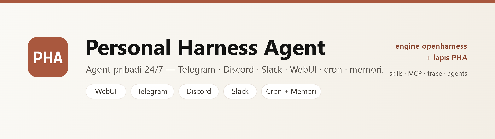
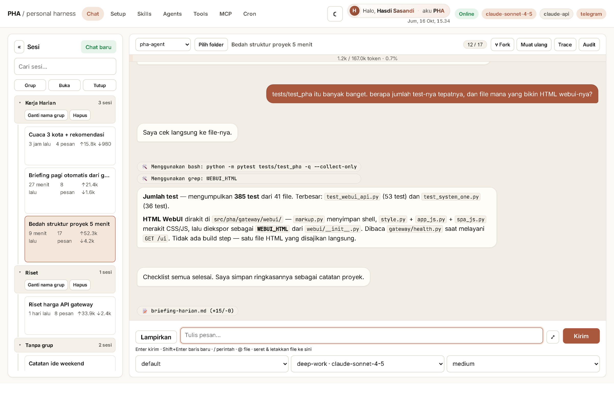
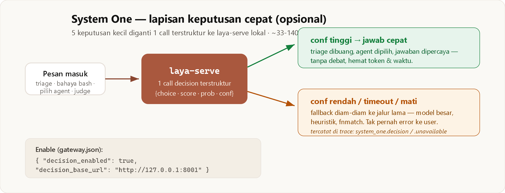

# PHA — Personal Harness Agent

A 24/7 personal agent: **Telegram/Discord/Slack** chat, local WebUI, cron, memory. Vendored OpenHarness engine (`src/openharness`) + PHA layer (`src/pha`).


By **Hasdi Sasandi** — [github.com/hasdisasandi/pha-agent](https://github.com/hasdisasandi/pha-agent).

> 🇮🇩 Baca dalam [Bahasa Indonesia](README.id.md).

## 5-minute start

```bash
pip install pha-agent
pha init        # wizard: LLM profile, API key, channel
pha doctor      # all ok / configured
pha gateway start --foreground  # Ctrl+C to stop
```

Open `http://localhost:18790/ui`. Done.

## WebUI



Multi-session chat with sidebar, SSE streaming, markdown, tool chips, todo cards, file diffs, Trace/Audit panels — plus Setup, Skills, Agents, Tools, MCP, and Cron pages. A single HTML file, no build step.

## System One — fast decisions, optional



Five small decisions (message triage, bash danger check, agent selection, compact check, answer judging) usually cost one full LLM call each. System One replaces them with **1 structured decision call** to a local `laya-serve` (`POST /v1/systemone`, Jev-compatible): ~33–140 ms, $0, data never leaves the machine. Low confidence, timeout, or server down → **silent fallback** to the legacy path, never an error to the user; everything is recorded in Trace.

```bash
laya-serve --port 8001
```

```json
{ "decision_enabled": true, "decision_base_url": "http://127.0.0.1:8001" }
```

Off by default = zero diff. Details: [`docs/prd/PRD-33-system-one.md`](docs/prd/PRD-33-system-one.md).

## What else it does

- **Multi-channel chat** — Telegram, Discord, Slack. One agent, every channel.
- **Local WebUI** — Chat/Setup/Skills/Agents/Tools/MCP/Cron + per-session Trace/Audit. SSE streaming, markdown, mermaid, upload/paste/drag-drop, `/` palette + `@` file mentions, dir picker (wcd), agent + effort picker, context bar, todo card, file diff.
- **Cron** — `pha cron add/list/enable/remove`, results land in chat / WebUI sessions.
- **Memory** — `~/.pha/memory/`, `soul.md`/`user.md`/`identity.md`, persistent across sessions.
- **10 built-in skills** — cron, github, image-generation, memory, weather, summarize, tmux, clawhub, skill-creator, update.
- **Provider fallback** — auto-switches when the primary fails (`provider_fallbacks` in `gateway.json`, legacy `config.json`).
- **Desktop GUI** — `pha gui [--engine webview|chrome|tk]`, `pha gateway start --gui`.

## Daily use

```bash
pha -p "summarize this report.md"
pha --continue -p "go on" / pha --resume <id> -p "redo in detail"
pha memory add prefs "Answer briefly, in English" / pha memory list / pha soul show
pha provider status / pha provider use openrouter / pha provider set-key / pha provider set-model gpt-4o-mini
pha cron add morning "0 8 * * *" --message "Plan the day" --channel telegram --chat-id 123
pha gateway allow telegram 123456789
```

## Gateway

```bash
pha gateway start [--foreground|--verbose|--gui] / pha gateway status|stop|restart
pha gateway install-service / pha gateway uninstall-service   # auto-start on boot
pha gateway start --workspace "D:\data\pha-work" --foreground --gui
```

| Flag | Meaning |
|---|---|
| `--workspace W` | Data root (`soul.md`, `sessions/`, `gateway.json`, `cron.json`, `agents.json`, `session_groups.json`, `engine/`…). Without `--cwd`, the workspace is the agent's working folder. Default `~/.pha`. |
| `--cwd D` | Agent's project folder. Always wins over `--workspace`. |
| `--gui` / `--gui-engine chrome\|webview\|tk` | Open the desktop WebUI after start. |

## WebUI / API

Default `http://localhost:18790/ui` (`health_port`/`health_host` in `gateway.json`). API: `POST /v1/chat/completions`, `POST /v1/chat/stream` (SSE), `GET /health`, `GET /status`. Full endpoint list: see `src/pha/gateway/health.py`.

- **Trace/Audit** — every run recorded (`~/.pha/logs/traces/`), global audit (`logs/audit.jsonl`, hashed senders). Delete per run / session.
- **Setup** — edit `gateway.json` from the browser (masked secrets, pydantic validation, restart banner when needed).
- **Effort** — `off|minimal|low|medium|high|xhigh|max`, global + per session. **Agent** — profiles in `agents.json` (tool+skill allowlists/mandatory sets, default effort).
- Non-loopback `health_host` requires `webui_token`.

## Config

One file: `~/.pha/gateway.json` (or `<workspace>/gateway.json`). Never commit it.

```bash
pha config --show   # effective JSON
pha config --full   # write ALL variables
```

Main knobs: `model/api_key/base_url/headers`, `effort/max_tokens/context_window_tokens/temperature/extra_body/max_turns`, `permission_mode/group_permission_mode` (`auto|default|plan`), `vision_model` (default `google/gemini-2.5-flash`, `"off"` disables), `disabled_tools/disabled_skills/allowed_tools/denied_tools/bash_allow_patterns/denied_commands`, `allowed_working_dirs`, `language` (`bahasa|english|japanese`), `webui_token_ttl_hours`, `decision_*`. Tables + recipes: [`docs/gateway-config.md`](docs/gateway-config.md).

Fallback (`gateway.json`; legacy `config.json` wins when both exist):

```json
{ "provider_fallbacks": [{ "model": "gpt-4o-mini", "base_url": "https://api.openai.com/v1", "api_key_env": "OPENAI_API_KEY", "transport": "requests", "verify_ssl": false }] }
```

Docker: `docker compose up -d` → `http://localhost:8787/ui` (compose mapping; native default 18790). Exe: `python scripts/build_exe.py` → `dist\pha.exe`.

## Security

- Empty `allow_from` = deny everyone. `pha gateway allow <channel> <id>`.
- `permission_mode: default` = write/execute tools pop up in the WebUI, denied in channels. `plan` = plan mode.
- Secrets (`gateway.json`, `config.json`, `cron.json`, `*.env`) are in `.gitignore`.

## Structure

```
src/openharness/   vendored engine (upstream + PHA patches)
src/pha/           product layer: workspace, persona, gateway, cron, WebUI, agents, trace
  gateway/session_pool.py|stream_updates.py|snapshots.py  runtime split
  gateway/webui/   build-free frontend (a single HTML file)
  skills/          10 built-in skills
tests/test_pha/    ~385 PHA tests (+ upstream engine suite)
docs/              gateway-config.md + docs/prd/ (PRD-1..48)
scripts/           build_exe.py + dev checkers
```


## Dev

```bash
pip install -e ".[dev]"
python -m pytest tests/test_pha -q
ruff check src/pha
```

16 upstream tests fail on pure Windows (Unix shells) — not a regression. `tests/test_pha` is green.

## Troubleshoot

| Symptom | Fix |
|---|---|
| `missing auth` | `pha provider set-key` / `use <profile>` |
| Port in use | `pha gateway status`, change `health_port`, restart |
| Channel silent | `allow_from` populated? allow + restart |
| Zscaler/TLS-intercept | `transport: "requests"`, `verify_ssl: false` |
| Cron never arrives | `pha cron list` enabled? gateway running? check Trace |

## License

MIT — [`LICENSE`](LICENSE). The engine embeds upstream OpenHarness code (MIT).
